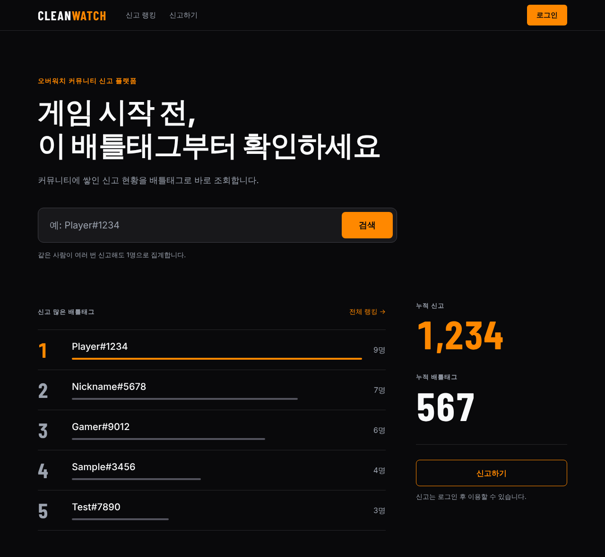

# CleanWatch

오버워치 배틀태그로 커뮤니티 신고 현황을 조회하고, 로그인한 이용자가 신고를 접수하는 서비스입니다.
Blizzard Entertainment와 무관한 비공식 커뮤니티 서비스입니다.

https://cleanwatch.cloud



샘플 데이터로 찍은 화면입니다.

## 하는 일

- 배틀태그를 검색하면 누적 신고 횟수와 최근 신고 시점을 보여 줍니다.
- 홈에서 신고가 많은 배틀태그 상위 5개와 누적 통계를, `/ranking`에서 전체 순위를 볼 수 있습니다.
- 로그인한 이용자는 배틀태그를 신고할 수 있습니다. 같은 배틀태그는 24시간에 한 번 다시 신고할 수 있습니다.
- 마이페이지에서 내 신고 내역을 보고 프로필을 수정합니다. 배틀태그를 등록하면 오버워치 프로필과 경쟁전 티어도 보입니다.
- 이메일 또는 Discord 계정으로 로그인합니다.
- 관리자는 접수된 신고를 열람하고 삭제할 수 있습니다.

## 설계 결정

### 신고 횟수는 "몇 명"이다

공개되는 숫자는 신고 건수가 아니라 신고한 사람 수입니다. 같은 사람을 또 만났을 때 기록할 수 있어야
하므로 재신고는 24시간에 한 번 허용하지만, 숫자는 첫 신고에만 올립니다. 한 사람이 숫자를 부풀릴 수
있으면 배틀태그에 붙은 숫자가 근거를 잃기 때문입니다. 삭제도 같은 원칙이라, 그 사람의 마지막 신고가
지워질 때만 숫자를 줄입니다.

신고는 이용자의 주장이며 운영자가 사실 여부를 검증한 것이 아닙니다. 자세한 내용은 이용약관을 참고하세요.

### 배틀태그 실존 확인은 막지 않고 경고만 한다

오버워치는 비공개 프로필도 404를 냅니다. 확인 결과로 저장을 막으면 비공개 사용자는 자기 배틀태그를
등록할 수 없습니다. 그래서 못 찾으면 한 번 경고하고, 다시 누르면 그대로 저장합니다.

서버도 "없음"을 404가 아니라 200 `{ exists: false }`로 내려서, 클라이언트가 "확실히 없다"와 "못
물어봤다"(상류 장애, 쓰로틀)를 구분합니다. 확인을 못 한 경우에는 통과시킵니다.

### 실패는 원인별로 나눠서 안내한다

토큰 없음, 권한 없음, 상류(OverFast) 장애, 상류에 없음은 서로 다른 상태 코드와 문구로 내려갑니다.
전부 "잠시 후 다시 시도해 주세요"로 합치면 사용자가 무엇을 해야 하는지 알 수 없습니다.

## 보안

- Firestore 규칙은 기본이 전체 차단입니다. 공개 데이터(배틀태그별 신고 수)와 본인 문서, 본인 신고의
  읽기만 열려 있고, 모든 쓰기는 막혀 있습니다.
- 서버는 `uid`를 요청 본문이 아니라 검증된 ID 토큰에서만 얻습니다.
- 신고 접수는 재신고 검사와 카운트 갱신을, 프로필 생성·수정은 형식·중복 검사와 쓰기를 한 트랜잭션으로
  묶습니다.
- Firestore와 Auth 클라이언트에 App Check(reCAPTCHA v3)를 연동했습니다.
- Cloudflare Turnstile로 회원가입, 비밀번호 재설정, 반복된 로그인 실패 뒤의 로그인을 보호합니다.
- Discord OAuth는 `state`를 쿠키와 대조해 CSRF를 막고, 인가 코드 교환은 서버에서 합니다. 로그인 토큰은
  URL 해시로 넘겨서 서버 로그에 남지 않습니다.
- 응답 헤더로 `X-Frame-Options: DENY`와 `X-Content-Type-Options: nosniff`를 내려보내고, CSP로
  스크립트·이미지·통신 출처를 허용 목록으로 제한합니다. 정책은 먼저 `Report-Only`로 배포해 위반이 없는
  것을 확인한 뒤 강제로 전환했습니다.
- `/api/stats/verify`는 uid별로 10분에 10회로 제한합니다. 상류(OverFast)의 레이트 리밋은 호출자 IP
  기준인데 그 IP가 우리 서버라서, 한 명이 많이 호출하면 모든 사용자의 전적 조회가 같이 막힙니다.
- 브라우저에 노출되는 공개값(Firebase 웹 설정, 사이트 키)과 비밀값(Admin SDK 개인 키, OAuth 시크릿)을
  구분해서 관리하고, `.env.example`에 어느 쪽인지 적어 두었습니다.

## 기술 스택

- 프론트엔드: React 19, TypeScript, Vite 8, React Router, TanStack Query, Zustand, Tailwind CSS
- 백엔드: Vercel Serverless Functions(`api/`), Firebase(Authentication, Cloud Firestore, App Check, Admin SDK)
- 외부 서비스: OverFast API(오버워치 프로필·티어), Discord OAuth2, Cloudflare Turnstile(봇 방어)
- CI: GitHub Actions(린트·타입 검사·빌드), 배포 후 스모크 테스트

## 구조

```text
project-root
├── api/                 # Vercel Serverless Functions. DB 쓰기와 외부 API 호출을 맡습니다.
│   ├── _lib/            #   Admin SDK, 토큰 검증, OverFast 클라이언트, uid별 쓰로틀
│   ├── auth/discord/    #   OAuth 인가·콜백 (코드 교환, 커스텀 토큰 발급)
│   ├── reports/         #   신고 접수·삭제
│   ├── stats/           #   OverFast 프록시 (내 전적, 배틀태그 실존 확인)
│   ├── users/           #   닉네임·배틀태그 중복 검사, 프로필 생성·수정
│   └── account/         #   회원 탈퇴 (신고 익명화, 문서 삭제, 계정 삭제 순)
├── src/                 # 프론트엔드
│   ├── api/             #   통신 계층. 인터셉터가 ID 토큰을 자동으로 붙입니다.
│   ├── pages/           #   화면 단위. 로직은 페이지별 hooks/로 나눕니다.
│   ├── components/      #   공용 UI
│   ├── hooks/queries/   #   React Query 훅 (서버 상태)
│   ├── store/           #   Zustand (클라이언트 전역 상태)
│   └── router/          #   lazy 로딩과 AsyncBoundary 기반 에러·서스펜스 처리
├── firestore.rules      # Firestore 보안 규칙. Firebase 콘솔에 붙여넣어 게시합니다.
└── vercel.json          # 보안 헤더(CSP 등)와 배포 설정
```

DB 쓰기는 모두 `api/`를 거칩니다. Firestore 규칙은 문서 하나만 보기 때문에 "중복 검사를 거쳤는지",
"짝이 되는 문서가 함께 생겼는지"를 표현할 수 없습니다. 그래서 클라이언트의 쓰기는 규칙에서 막고,
서버가 트랜잭션으로 검사한 뒤 Admin SDK로 씁니다. Admin SDK는 규칙을 우회합니다.

## 실행

```bash
npm ci
vercel dev
```

`npm run dev`는 프론트엔드만 띄워서 API 호출이 모두 실패하므로 `vercel dev`를 씁니다. 처음에는
Vercel 로그인과 프로젝트 연결이 필요할 수 있습니다. 필요한 환경 변수는 `.env.example`에 있습니다.

로컬에서도 운영 Firebase에 연결되므로, 회원가입이나 신고 폼을 제출하면 실제 데이터가 생깁니다.

변경한 뒤에는 `npm run lint`와 `npm run build`가 통과하는지 확인합니다.

## 기여

브랜치를 만들어 PR을 올리고, CI를 통과하면 머지합니다. `main`에는 직접 푸시하지 않습니다.
규칙은 [CONTRIBUTING.md](CONTRIBUTING.md)에 있습니다. 작업 이력과 판단 근거는
[Pull requests](https://github.com/CleanWatch/Clean.Watch/pulls?q=is%3Apr+is%3Aclosed)에 있습니다.

## 팀

| GitHub                                                 | 역할                                                                         |
| ------------------------------------------------------ | ---------------------------------------------------------------------------- |
| **[@pandemoniummm](https://github.com/pandemoniummm)** | 프론트엔드 리드, 아키텍처 총괄. TypeScript 이주, 보안 아키텍처 재설계, CSP   |
| [@Ryanghyeon](https://github.com/Ryanghyeon)           | 백엔드·인프라 초기 세팅. Admin SDK 구조, OAuth 콜백 라우팅, Vercel 초기 배포 |
| [@ininin0423](https://github.com/ininin0423)           | 프론트엔드 UI 서포트. 초기 UI 컴포넌트, App Check 연동                       |
